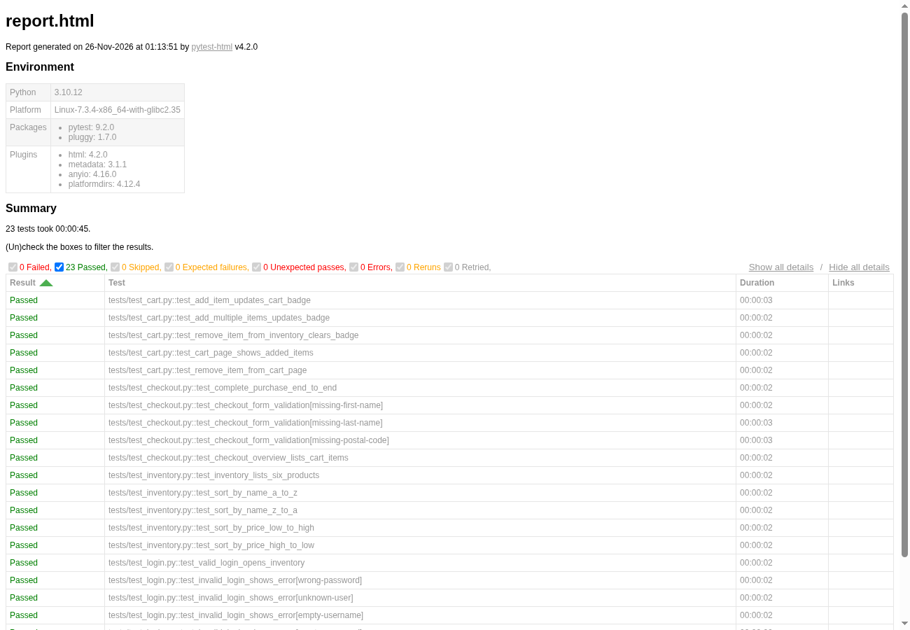

# SauceDemo UI Test Automation (Selenium + Python + pytest)

Automated UI test suite for the public practice shop [saucedemo.com](https://www.saucedemo.com), built with the **Page Object Model**, explicit waits, parametrized tests, HTML reporting, failure screenshots, and a **GitHub Actions** pipeline.



## What it covers

| Area | Scenarios | Tests |
|---|---|---|
| Login | valid login, wrong password, unknown user, empty fields, locked-out user, logout | 8 |
| Inventory | product count, sort by name (A-Z, Z-A), sort by price (low-high, high-low) | 5 |
| Cart | add, add multiple, remove, cart contents, remove from cart page | 5 |
| Checkout | end-to-end purchase, form validation (3 cases), order overview | 5 |
| **Total** | | **23** |

Tests are tagged `smoke` (critical flows) and `regression` (everything).

## Tech stack

- Python 3.10+
- Selenium 4 (Selenium Manager downloads the matching ChromeDriver automatically)
- pytest, pytest-html
- GitHub Actions for CI

## Project structure

```
.
├── conftest.py            # driver fixture, --headed option, screenshot on failure
├── pytest.ini             # markers, report settings
├── pages/                 # Page Object Model
│   ├── base_page.py       # explicit waits and shared helpers
│   ├── login_page.py
│   ├── inventory_page.py
│   ├── cart_page.py
│   └── checkout_page.py
├── tests/
│   ├── test_login.py
│   ├── test_inventory.py
│   ├── test_cart.py
│   └── test_checkout.py
└── .github/workflows/tests.yml
```

## Setup

```bash
git clone https://github.com/Belaalos/saucedemo-selenium-pytest.git
cd saucedemo-selenium-pytest
python -m venv .venv
# Windows: .venv\Scripts\activate    |    macOS/Linux: source .venv/bin/activate
pip install -r requirements.txt
```

Google Chrome must be installed.

## Run the tests

```bash
pytest                      # all tests, headless
pytest --headed             # watch the browser
pytest -m smoke             # only the critical flows
pytest tests/test_login.py  # one file
```

Results are written to `reports/report.html`. Screenshots of failed tests are saved to `screenshots/`.

## Continuous integration

Every push and pull request runs the full suite in headless Chrome on GitHub Actions. The HTML report and any failure screenshots are uploaded as a build artifact (Actions tab > latest run > Artifacts).

## Design notes

- **Page Object Model** keeps locators in one place, so a UI change means one edit, not twenty.
- **Explicit waits only** (no `sleep`), which keeps the tests stable and fast.
- **Parametrized tests** cover several negative cases without duplicated code.
- Test data uses the public demo credentials published on the SauceDemo login page.

## Author

Belal Magdy | Software Testing & QA Automation | [LinkedIn](https://www.linkedin.com/in/belal-magdy-23sep2001)
